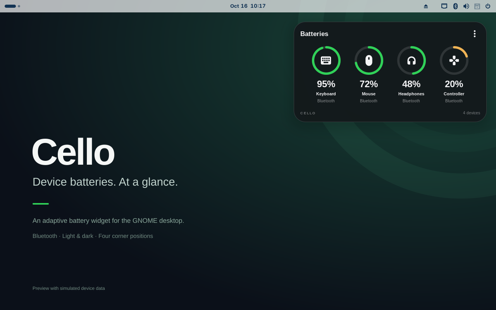

# Cello — Desktop Batteries

Device batteries. At a glance.

Cello is a small, wallpaper-aware battery widget for the GNOME desktop. It shows Bluetooth device icons, charge rings and readable percentages without scanning or connecting to your devices.



**Initial preview: GNOME Shell 46 only.** English and Italian are included. The GNOME Extensions submission is pending; this repository does not imply approval by GNOME.

[User guide](docs/USER_GUIDE.md) · [Guida italiana](docs/GUIDA_UTENTE.md) · [Screenshot gallery](docs/media/releases/v0.1.0-rc.1/README.md) · [Release notes](docs/release/v0.1.0-rc.1.md)

## What it does

- Displays up to six connected devices, with automatic wrapping.
- Adapts light/dark appearance and tint to the wallpaper underneath the widget.
- Offers four corner positions within the primary monitor's usable area.
- Opens a native menu with right-click, the ⋮ button or Menu/Shift+F10 while focused.
- Handles unknown battery levels honestly, using `—` rather than an invented percentage.
- Optionally reads an existing Keychron bridge snapshot, preserving `~` for estimated charge.

Battery availability depends on the device and the information exposed by BlueZ. Cello cannot obtain readings that the system does not provide. The optional bridge is not required for standard Bluetooth devices and is not bundled or installed.

## Install

Download the `.shell-extension.zip` from [Releases](https://github.com/ATAC-Helicopter/Cello/releases), then:

```sh
gnome-extensions install --force keychron-batteries-widget@fglabs.local.shell-extension.zip
```

Log out and back in, then enable **Cello — Desktop Batteries** in the Extensions application, or:

```sh
gnome-extensions enable keychron-batteries-widget@fglabs.local
```

On Wayland, a new login is needed to load updated JavaScript modules. Disabling/enabling an already loaded extension does not reload its source.

For a source checkout, run `npm ci`, `npm run translations`, then `./install.sh`. The installer backs up the previous extension and preserves preferences. Node/npm are development tools and are not required to run an installed ZIP.

The stable UUID is retained to upgrade the original local widget without installing a duplicate. Preferences are stored in `${XDG_CONFIG_HOME:-~/.config}/keychron-batteries-widget.json`. Use the menu or `./set-position.sh bottom-right` to move the widget.

## Low background activity

Cello subscribes to BlueZ events and reads the daemon's local battery cache. It performs an initial snapshot, resynchronizes after a daemon restart, and allows a manual cache refresh. It does not start discovery, pair, connect, read GATT characteristics or write HID commands.

There is no recurring polling timer. Event bursts are batched and unchanged data preserves the actor tree. Wallpaper decoding is asynchronous and retained as a thumbnail of at most 128×128 pixels. The optional bridge file is monitored; a one-shot expiry prevents stale readings from being presented as current.

A local 22-second idle observation recorded **zero additional BlueZ snapshots and zero widget rebuilds**. This is an activity count, not a measurement of watts, device battery life or CPU/RAM overhead. BlueZ and an optional external bridge have independent behavior and costs.

No network service, telemetry or account is used by the extension.

## Validation and limitations

```sh
npm ci
npm run translations
npm run lint
npm run test:bluez
npm run test:desktop
./tools/package.sh
```

The BlueZ test uses a fake daemon on a private session bus. The GNOME smoke test uses an isolated Shell and settings, exercises real pointer events and captures screenshots. Simulated readings are not hardware qualification. See [Contributing](CONTRIBUTING.md) for details.

Current limitations:

- GNOME Shell 46 is the only tested/supported version.
- Real multi-monitor and HiDPI setups remain to be qualified.
- The primary Wayland desktop needs a new login before final installed-session visual qualification.
- XML slideshows and unreadable wallpaper files use a fallback tint. No screen blur is applied.
- The external Keychron bridge is separately installed and maintained; Cello reads `/run/keychron-battery/state.json` only if available.

The public preview uses an original project wallpaper and clearly marked simulated devices. Private desktop screenshots, backups and local logs are excluded from this repository.

## Development and distribution

[Publishing guide](docs/PUBLISHING.md) · [Review checklist](docs/REVIEW.md) · [Contributing](CONTRIBUTING.md) · [Security](SECURITY.md)

The release also includes a separate documentation/media kit with ten screenshots, bilingual user guides, listing copy and provenance manifests. Build it with `python3 tools/build-release-kit.py`. It is not the installable extension.

`tools/package.sh` builds an installable ZIP with runtime files, translations and the license. Installers, test code and promotional media are excluded from the ZIP. GitHub Actions checks lint, Bluetooth events, packaging and GNOME desktop behavior.

## License

GPL-3.0-or-later. See [LICENSE](LICENSE) and [provenance notes](NOTICE.md).
