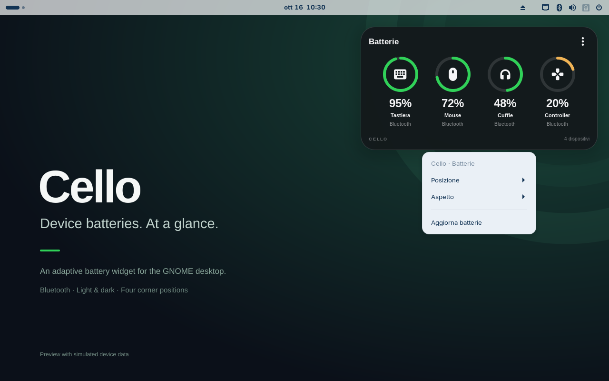

# Guida a Cello

Cello 0.1.0-rc.1 è un’anteprima pubblica per GNOME Shell 46. La pubblicazione su GNOME Extensions è ancora in attesa di invio. La lingua segue quella del desktop: sono disponibili inglese e italiano.

## Installazione e aggiornamento

Scarica lo ZIP dell’estensione e `SHA256SUMS` dalla [release](https://github.com/ATAC-Helicopter/Cello/releases/tag/v0.1.0-rc.1). Nella cartella dei due file esegui:

```sh
sha256sum --check SHA256SUMS
gnome-extensions install --force keychron-batteries-widget@fglabs.local.shell-extension.zip
```

Salva il lavoro, esci dalla sessione e rientra. Poi abilita **Cello — Desktop Batteries** nell’app Estensioni oppure con:

```sh
gnome-extensions enable keychron-batteries-widget@fglabs.local
```

L’identificatore resta quello del widget originale, così l’aggiornamento non crea duplicati. Su Wayland un nuovo accesso è necessario per caricare il codice aggiornato. Node e npm servono soltanto allo sviluppo.

## Leggere il widget


L’icona indica il tipo di dispositivo. L’anello rappresenta la carica, riportata anche in percentuale. Sono visibili fino a sei dispositivi, con disposizione automatica su più righe. I nomi lunghi vengono abbreviati.

| Indicazione | Significato |
| --- | --- |
| `95%` | Livello disponibile nella cache di BlueZ. |
| `~95%` | Stima fornita dal bridge Keychron opzionale. |
| `—` / No livello | Dispositivo connesso senza una percentuale disponibile. |
| `USB` | Il bridge segnala alimentazione USB; la stima derivata dalla tensione non viene presentata come carica misurata. |
| In attesa | La lettura del bridge è obsoleta. |
| Non connessa | La tastiera segnalata dal bridge non è collegata. Gli altri dispositivi Bluetooth disconnessi spariscono dall’elenco. |

Il colore è verde sopra il 30%, ambra dal 16 al 30%, rosso dal 0 al 15%. Per un valore sconosciuto l’anello è neutro. Il colore non predice il tempo di autonomia residua.

## Menu, posizione e aspetto



Apri il menu con il tasto destro sulla scheda o con **⋮**. Con il widget a fuoco funzionano anche il tasto Menu e Maiusc+F10. Esc e il clic esterno lo chiudono.

- **Posizione** sceglie uno dei quattro angoli dell’area utile del monitor principale. In questa versione il widget non si trascina liberamente.
- **Aspetto** sceglie chiaro, scuro o automatico. L’automatico riprende i colori dello sfondo sotto la scheda, senza sfocare lo schermo.
- **Aggiorna batterie** rilegge la cache locale e il file del bridge. Non invia al dispositivo un comando per svegliarlo o effettuare una misura.

Il widget resta sul desktop, sotto le normali finestre. Tiene conto dell’area occupata da pannelli e dock; più monitor e HiDPI reali restano da qualificare.

## Bluetooth e bridge Keychron

Cello funziona con i normali dispositivi BlueZ senza servizi Keychron aggiuntivi. Un dispositivo può mostrare `—` se non espone il livello batteria al sistema.

Il bridge opzionale viene letto soltanto se esiste il file `/run/keychron-battery/state.json`. Cello non lo installa né lo avvia. Il prefisso `~` conserva il significato di stima. Un timestamp più vecchio di 180 secondi rende la lettura obsoleta, anche se il file non viene più aggiornato.

## Problemi comuni

| Problema | Controllo |
| --- | --- |
| Il widget non appare | Verifica GNOME Shell 46, esci/rientra e abilita l’estensione. Usa `gnome-extensions info keychron-batteries-widget@fglabs.local` per leggerne lo stato. |
| Vedi ancora il vecchio widget | Su Wayland serve un nuovo accesso: disabilitare e riabilitare mantiene i moduli già importati. |
| Nessun dispositivo | Controlla le connessioni nelle impostazioni Bluetooth del desktop. Cello non effettua scansioni o connessioni. |
| Percentuale assente | BlueZ non ha un livello da mostrare. Il refresh non può crearne uno. |
| Colore diverso dal previsto | Sfondi XML o file non leggibili usano una tinta di riserva. Puoi scegliere chiaro/scuro manualmente. |

Per segnalare un difetto apri una [issue](https://github.com/ATAC-Helicopter/Cello/issues/new/choose) indicando distribuzione, versione GNOME, release e passaggi per riprodurlo. Rimuovi indirizzi personali dei dispositivi da log e immagini.

## Disattivazione e rimozione

```sh
gnome-extensions disable keychron-batteries-widget@fglabs.local
gnome-extensions uninstall keychron-batteries-widget@fglabs.local
```

Il comando di GNOME lascia le preferenze in `${XDG_CONFIG_HOME:-~/.config}/keychron-batteries-widget.json`. Lo script `uninstall.sh` del sorgente elimina anche quel file; i backup dell’installer rimangono disponibili.

## Consumi: cosa sappiamo

Il widget usa gli eventi locali, senza polling ricorrente e senza comandi di scansione, associazione, connessione, lettura GATT o scrittura HID. In una prova locale di 22 secondi a riposo sono state contate zero richieste complete aggiuntive a BlueZ e zero ricostruzioni della grafica. La prova non misura watt, CPU/RAM o autonomia reale. BlueZ e il bridge esterno hanno un comportamento separato.

Tutte le letture nelle immagini sono dichiaratamente simulate. Gli screenshot mostrano l’interfaccia vera, renderizzata in una sessione GNOME isolata, non misure hardware.
