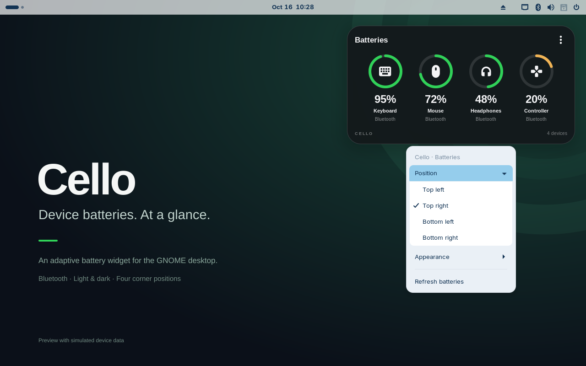
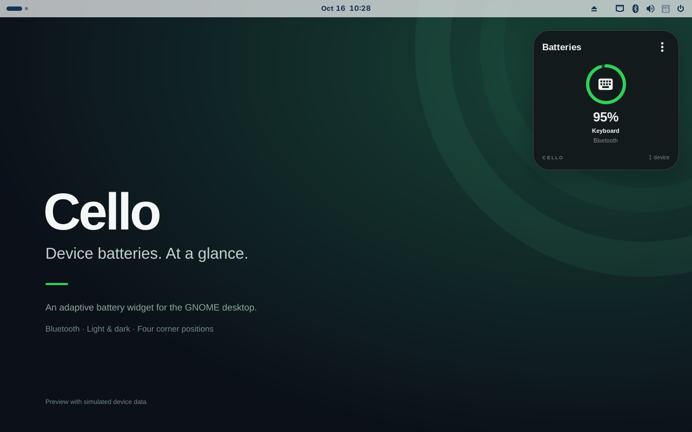

# Cello user guide

Cello 0.1.0-rc.1 is a public preview for GNOME Shell 46. [GNOME Extensions submission #11286](https://extensions.gnome.org/extension/11286/cello-desktop-batteries/) is awaiting review; store installation is not yet available. English and Italian are selected through your desktop language.

## Install or update

1. Open the [release page](https://github.com/ATAC-Helicopter/Cello/releases/tag/v0.1.0-rc.1).
2. Download the `.shell-extension.zip` and `SHA256SUMS` into the same folder.
3. Check the download and install it:

```sh
sha256sum --check SHA256SUMS
gnome-extensions install --force keychron-batteries-widget@fglabs.local.shell-extension.zip
```

4. Log out and log back in. Save your work before logging out.
5. Enable **Cello — Desktop Batteries** in the Extensions application, or run:

```sh
gnome-extensions enable keychron-batteries-widget@fglabs.local
```

The same UUID updates the original widget. On Wayland, disabling/enabling does not reload already imported JavaScript modules; use a new login after an update. Node/npm are not needed to run the release ZIP.

## Read the widget


The icon identifies the device type; the ring shows the fraction of charge; the percentage below it is the reported value. Names may be shortened to fit. Up to six devices are shown, with devices that provide battery levels listed first.

| Display | Meaning |
| --- | --- |
| `95%` | Battery level exposed by BlueZ. |
| `~95%` | An estimated reading from the optional Keychron bridge. |
| `—` / Unavailable | A connected device is present, but a level is not available. |
| `USB` | The optional bridge reports USB power; Cello does not present that voltage-derived value as battery charge. |
| Waiting for a reading | A bridge reading has become stale. |
| Disconnected | A keyboard reported by the optional bridge is no longer connected. Ordinary disconnected Bluetooth devices disappear from the list. |

Known levels above 30% use green, 16–30% use amber, and 0–15% use red. A neutral ring accompanies an unknown level. These colors are UI thresholds, not predictions of remaining runtime.

## Open the menu


Right-click inside the card or click **⋮**. When the widget has keyboard focus, Menu or Shift+F10 also opens the menu. Esc or a click outside closes it.

- **Position** places the card in one of the four corners of the primary monitor's usable area.
- **Appearance** selects Automatic, Light or Dark. Automatic samples the wallpaper beneath the card; it does not blur screen contents.
- **Refresh batteries** refreshes Cello's local view of the BlueZ cache and bridge file. It does not ask the device to wake or take a new hardware measurement.



Position is selected from corners; arbitrary dragging is not part of this preview. Panel/dock work areas are considered. Real multi-monitor and HiDPI behavior remains under qualification.

## Light, dark and compact layouts





The card wraps automatically. Device names, percentages and supported menu controls shown in these images are rendered by the released extension. Readings are simulated; they are not hardware measurements.

## Optional Keychron bridge

Cello works with ordinary BlueZ devices without a Keychron service. If an existing bridge writes `/run/keychron-battery/state.json`, Cello can read it asynchronously. The bridge supplies the device identity and estimated level. It is not bundled, installed or started by Cello.

A reading with a timestamp older than 180 seconds is treated as stale; a one-shot expiry updates the view even if the bridge stops writing. Repeated bridge updates that do not change the displayed data preserve the widget's actor tree.

## Troubleshooting

| Symptom | Check |
| --- | --- |
| Widget does not appear after installation | Use GNOME Shell 46, log out/in and enable the extension. `gnome-extensions info keychron-batteries-widget@fglabs.local` shows its status. |
| Old design or menu after an update | Start a new Wayland login; toggling the extension retains imported modules. |
| No devices connected | Check connections through the desktop Bluetooth settings. Cello does not discover or connect devices itself. |
| Device shows `—` | That device/BlueZ combination has not exposed a battery level. Manual refresh cannot manufacture one. |
| Colors do not match the wallpaper | XML slideshows and unreadable files use a fallback tint. Light/Dark can be selected manually. |
| Widget is covered by an application | This is expected: the card belongs to the desktop layer and stays below normal application windows. |

For a bug, open an [issue](https://github.com/ATAC-Helicopter/Cello/issues/new/choose) with distribution, GNOME version, release and reproduction. Attach only relevant logs/screenshots and remove personal device addresses.

## Disable or remove

```sh
gnome-extensions disable keychron-batteries-widget@fglabs.local
gnome-extensions uninstall keychron-batteries-widget@fglabs.local
```

Preferences remain at `${XDG_CONFIG_HOME:-~/.config}/keychron-batteries-widget.json` when using GNOME's uninstall command. The source-checkout `uninstall.sh` also removes that preferences file; installer backups remain under the configured state directory.

## What is measured

Cello uses local events, has no recurring polling timer and issues no discovery, pairing, connection, GATT-read or HID-write commands. A 22-second local idle observation counted zero extra BlueZ snapshots and zero widget rebuilds. It does not establish watt usage, CPU/RAM overhead or device battery life. The external bridge and BlueZ have their own behavior.
