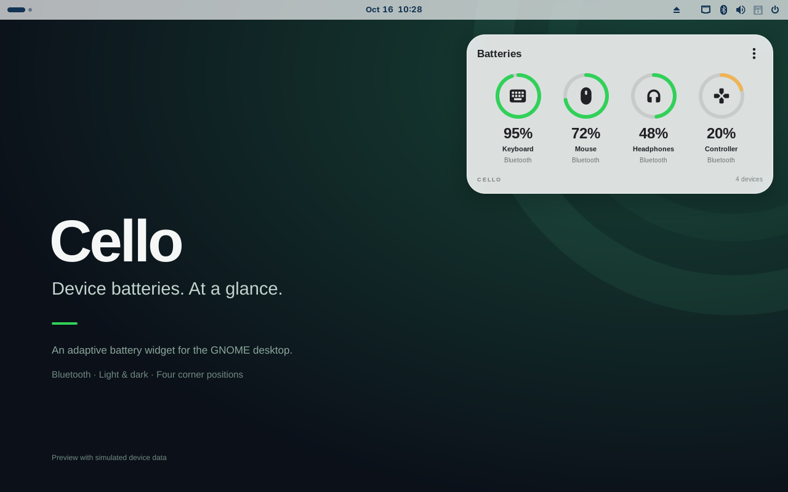
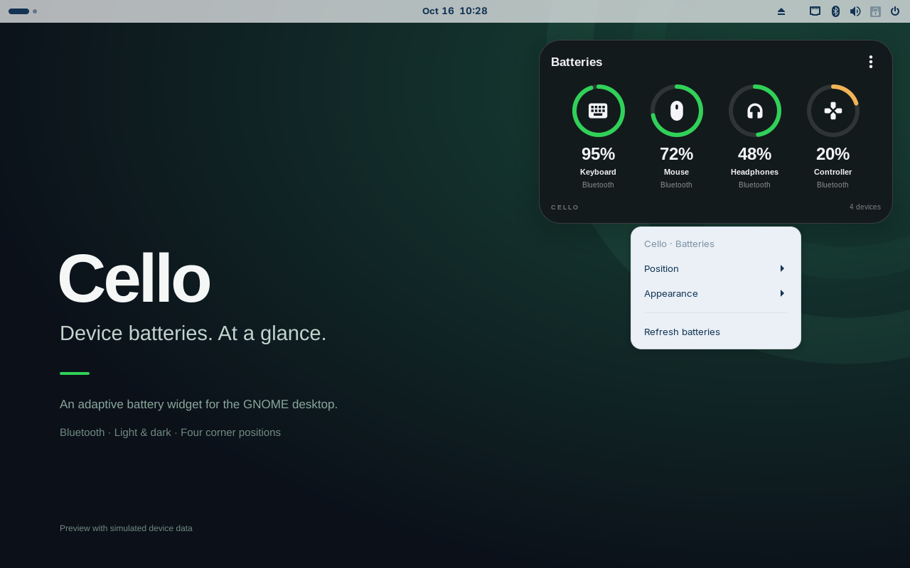
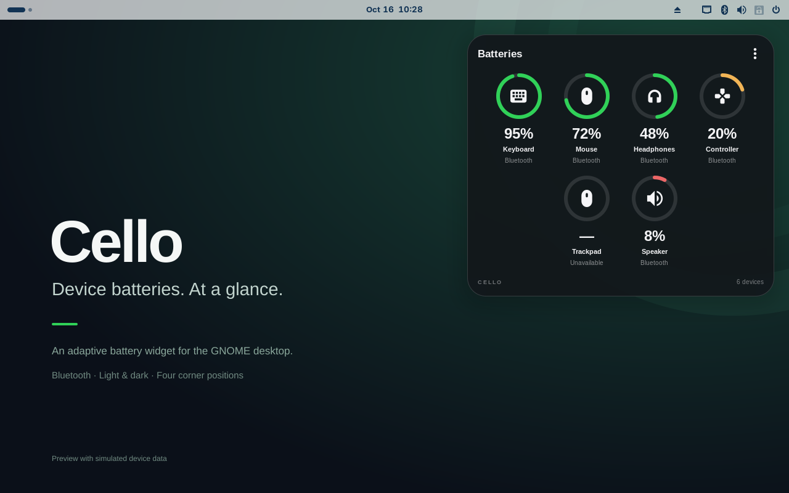
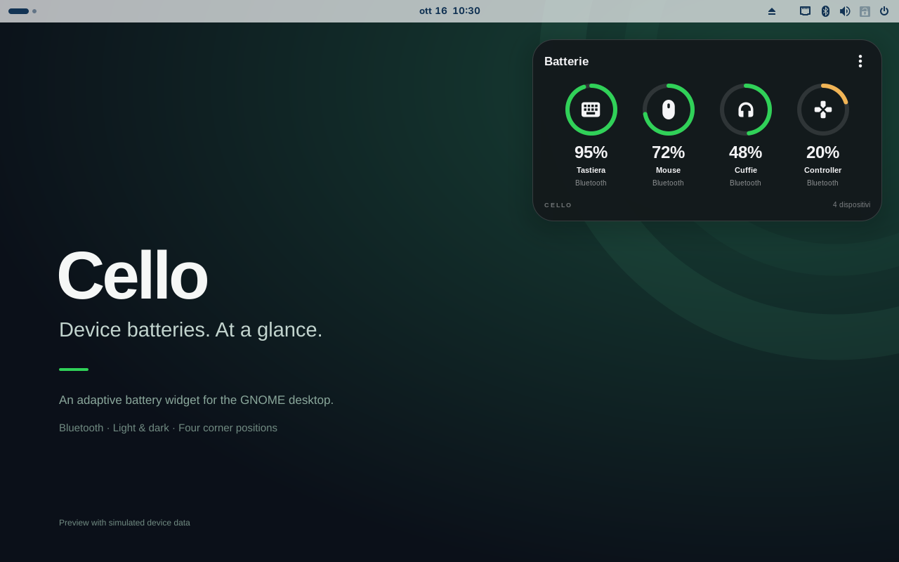

# Cello 0.1.0-rc.1 screenshot gallery

These are unretouched 1280×800 screenshots from the released widget running in an isolated GNOME Shell 46 session. All readings are simulated. The original project wallpaper carries the disclosure. The widget is rendered by GNOME; it is not a mockup.

The EN/IT capture manifests record runtime commit, release-archive hash, language, dimensions and PNG hashes. Capture-only instrumentation uses a temporary copy to enable private-bus automation, redirect the optional bridge path and replace live data with fixtures. Repository runtime files are unchanged.

| Image | Language | Caption |
| --- | --- | --- |
| [01-overview.png](01-overview.png) | en | Four connected devices in dark appearance; simulated readings. |
| [02-light.png](02-light.png) | en | Light appearance on the original project wallpaper; simulated readings. |
| [03-context-menu.png](03-context-menu.png) | en | Context menu opened with a real virtual-pointer right-click; simulated readings. |
| [04-position-menu.png](04-position-menu.png) | en | Four desktop corner choices in the native menu; simulated readings. |
| [05-appearance-menu.png](05-appearance-menu.png) | en | Automatic, light and dark appearance choices; simulated readings. |
| [06-six-devices.png](06-six-devices.png) | en | Six devices wrap into two rows; unknown and low charge examples are simulated. |
| [07-compact.png](07-compact.png) | en | A single device uses a compact card; simulated reading. |
| [08-empty-state.png](08-empty-state.png) | en | Empty state without a bridge or connected devices; captured in an isolated session. |
| [09-italiano.png](09-italiano.png) | it | Italian translation, dark appearance; simulated readings. |
| [10-menu-italiano.png](10-menu-italiano.png) | it | Native context menu in Italian; simulated readings. |

## Overview


## Light appearance



## Context menu



## Six devices



## Italiano



## Reproduce and reuse

From the repository, with the released extension ZIP in `dist/`:

```sh
python3 tools/capture-release.py
python3 tools/capture-release.py --language it
python3 tools/check-release-docs.py
python3 tools/build-release-kit.py
```

The Italian capture requires `it_IT.UTF-8` on the capture host. The script verifies that every runtime file in the ZIP matches the release tag. Do not run its instrumentation in the active desktop session. Media is captured through GNOME's Screenshot D-Bus API, without editing the PNGs afterward.

The project-created wallpaper and captures use GPL-3.0-or-later. Preserve the simulated-data disclosure and the captions. Do not describe the screenshots as hardware/battery-life validation or evidence of GNOME Extensions approval.
